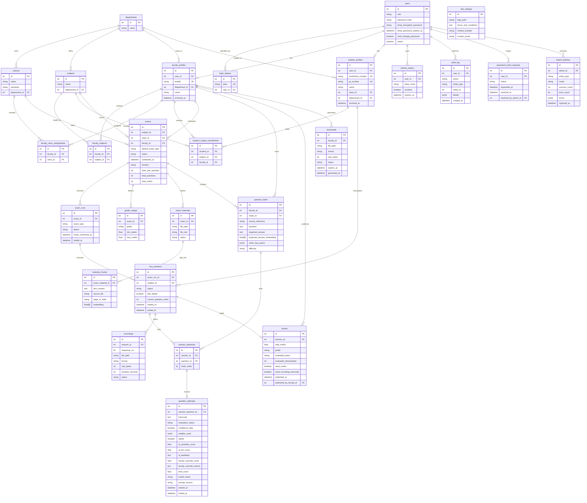

# Architecture

## Overview
- **Frontend**: Next.js (App Router), React, Tailwind CSS, shadcn/ui.
- **Backend**: Python 3.12, FastAPI, Uvicorn.
- **Database**: PostgreSQL 18.6 with SQLAlchemy 2.x and Alembic. Embeddings stored as float arrays (no pgvector).
- **Cache/Queue**: Redis (caching, celery broker, websockets).
- **AI/ML**: `faster-whisper` (STT), Sentence Transformers (embeddings), Ollama (local LLM for generation/grading).
- **Storage**: Local filesystem via a `StorageBackend` interface (planned MinIO for prod).
- **Communication**: REST API (unary calls) + WebSockets (real-time viva state).

## Mermaid ER Diagram

## Constraints & Indexes
1. `login_aliases.alias` is strictly unique. This prevents GR number, enrollment number, empID, or username collisions.
2. Unique Constraint `(exam_run_id, student_id)` on `viva_sessions`.
3. Unique Constraint `(faculty_id, class_id)` on `faculty_class_assignments`.
4. Unique Constraint `(student_id, subject_id)` on `student_subject_enrollments`.
5. Partial Unique Index for **one active run per exam** on `exam_runs`.
6. `role` and all `status` columns are strictly controlled via PostgreSQL Enums or `CHECK` constraints.
7. `site_settings` enforced to a single row globally.
